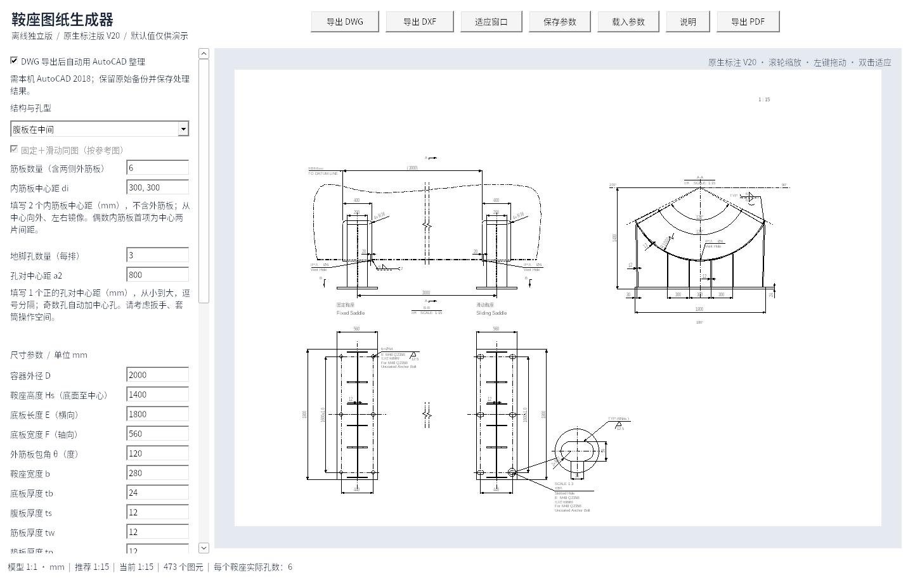
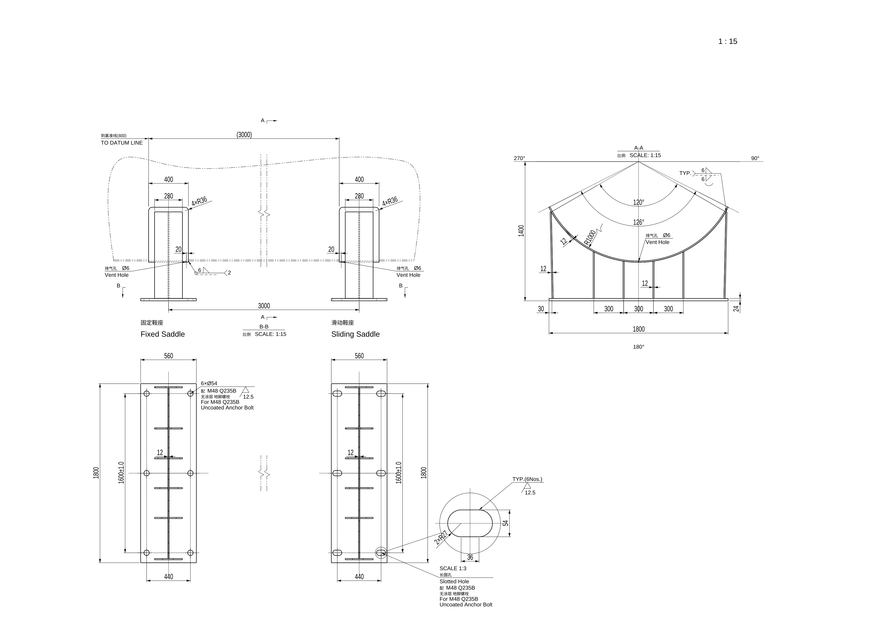

# 鞍座图纸生成器 V20

Windows 10/11 x64 单文件程序。基础生成可离线运行；新增导出后自动整理需要本机 AutoCAD Mechanical 2018 / AutoCAD 2018。

## 下载

- **[单文件 EXE，直接下载运行](https://github.com/JaxonWang888/123/raw/refs/heads/main/releases/saddle-generator-v20.exe)**
- [完整程序包：说明、示例 DWG/DXF/PDF、参数和验证报告](https://github.com/JaxonWang888/123/raw/refs/heads/main/releases/saddle-offline-v20.zip)
- [完整对应源码和构建脚本](https://github.com/JaxonWang888/123/raw/refs/heads/main/releases/saddle-source-v20.zip)
- [SHA-256 校验值](releases/SHA256SUMS.txt)

将 EXE 放入 `C:\Users\20202012\Desktop\鞍座自动生成` 后双击运行。说明、示例与源码不是运行依赖。

## 本次更新：设备距离、剖视与筋板焊接

- 新增“鞍座到基准线的距离”“鞍座之间的距离”“外侧筋板与鞍座垫板焊脚”。
- 到基准线参考值＝输入距离－Wp/2；上方参考间距和下方底板中心间距均显示输入鞍座间距，断开示意图的绘制间距不变。明确的尺寸文字覆盖会在自动整理时保留。
- 增加A/B剖视箭头、A-A/B-B视图标题及图纸比例，以及270°、90°、180°方位标识。
- 外侧筋板与垫板增加TYP.双面焊及弧形轮廓，焊脚用户输入，不保留1.0tmin。
- 参数文件升级V7，兼容旧参数文件；旧文件的新参数使用演示默认值，出图前请核对。

## 保留：DWG 自动打开与标注整理

默认勾选“DWG 导出后自动用 AutoCAD 整理”，保存DWG后连接或启动2018：

- 外来DWG选继续打开；是否取消打开选否；需要修复选修复；修复报告选关闭。
- 本次图纸的原生尺寸改为 HM-ASME 1-1、文字旋转0、全局比例等于图纸比例；保留长圆孔实值文字及测量换算。
- 保存后保持图纸打开，并保留原始DWG备份和处理日志。未知提示保留人工处理，不修改全局提示选项。

取消勾选可继续使用原来的离线导出。预览、DXF、PDF和包内原始示例不经过本机CAD自动整理。

已测试Windows COM模拟、已知标准窗口按钮处理、基础导出和无CAD时的真实子进程失败路径；**尚未在真实Mechanical2018中验收COM连接、现代提示、修复和保存全过程**。需要2018已完成首次启动，生成器与CAD使用相同运行权限。

DXF 为 2004 格式；DWG 含原生折弯半径扩展实体，请使用支持此标注类型的 CAD。

主图毫米模型 1:1，所有尺寸为 CAD 原生 DIMENSION / LARGE_RADIAL_DIMENSION，使用 HM 1-1，图层为“6 尺寸线-管口号外圆（细实线）”，全局比例等于图纸比例。仅长圆孔的放大复制图采用标示放大比例，标注仍显示孔的实际尺寸。中文宋体，英文数字 Arial。

保留之前的外筋板接触点、截平端面、实际投影、镜像侧腹板、对称孔、独立内筋板间距、非交叠原生剖面、自动比例具体值和滚动重绘。仍不生成 Note、BOM、泡泡号、Ls、向视符号及过程角度；排气孔、缺口、地脚孔注释和焊接符号保留，注释连接使用普通箭头和线条。

## 验证与使用范围（基础导出）

Windows EXE 在 Wine 10 中完成 189 项交互/导出检查；42 份常规 CAD 文档和 8 份比例文档独立审计错误与修复均为 0。独立重生成角度尺寸恢复为 450/650 mm 弧半径；1:2.5、1:5、1:25、1:40 的实体和样式全局比例均核对一致。25 份 DWG 原始文字流通过 Unicode 与字体检查，21 份 PDF 保持黑白矢量。完整数据和验证报告在程序包内。

当前环境没有 AutoCAD Mechanical 2018，尚未进行该软件的实机打开、重生成、编辑、保存和打印验收。默认参数仅作演示，不执行强度计算。PDF 文字转为字体轮廓，CAD 文字和标注可编辑。

GNU LibreDWG 及程序遵循 GPL-3.0-or-later；许可证和完整对应源码随包提供。历史版本在 releases 目录保留。
