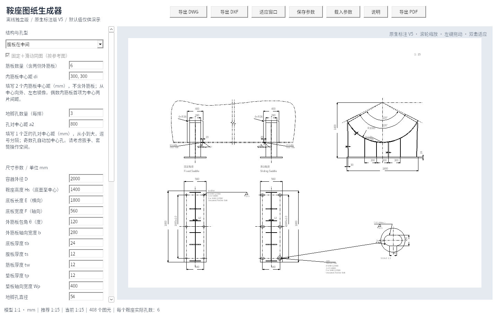
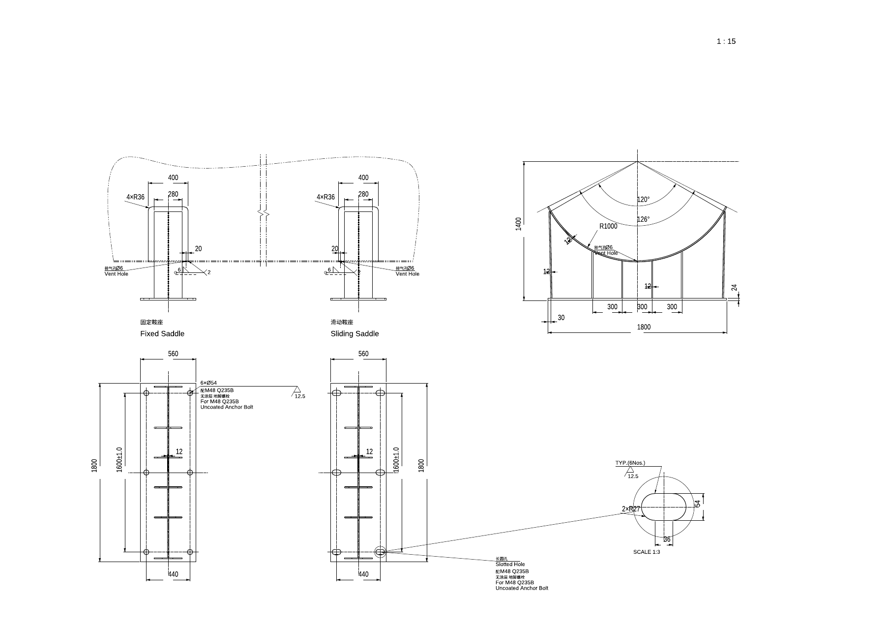

# 鞍座图纸生成器 V5

Windows 10/11 x64 离线单文件程序，无需 AutoCAD、Python 或联网运行。

## 下载

- **[单文件 EXE，直接下载运行](https://github.com/JaxonWang888/123/raw/refs/heads/main/releases/saddle-generator-v5.exe)**
- [完整程序包：说明、示例 DWG/DXF/PDF、参数和验证报告](https://github.com/JaxonWang888/123/raw/refs/heads/main/releases/saddle-offline-v5.zip)
- [完整对应源码和构建脚本](https://github.com/JaxonWang888/123/raw/refs/heads/main/releases/saddle-source-v5.zip)
- [SHA-256 校验值](releases/SHA256SUMS.txt)

将 EXE 放入 `C:\Users\20202012\Desktop\鞍座自动生成` 后双击运行。说明、示例与源码不是运行依赖。

## 本次更新

- 单行文字及注释引线统一使用“2 明细栏-技术特性表-剖面线-管口表-管口载荷表（细实线）”。
- 垫板内侧厚度线整段虚线；两种投影添加排气孔隐藏线和中英文引线。
- 增加筒体双点划线示意，使用“5 断开线（双点划线）”；新增“鞍座垫板与筒体焊脚”参数驱动焊接符号，保留圆圈、补充虚线、尾部数字 2。
- 垫板内增加实际半径标注。腹板缺口增加 WEB GAP 引线、径向 50 mm 和两个已确认交点间的实际参考尺寸。
- 同排同列地脚孔用中心线连接，标注对称孔的完整距离及原生 ±1.0 mm 公差；列间距移到最下排。
- 圆孔使用数量/直径引线，长圆孔有放大图，标注真实尺寸、数量与粗糙度 12.5。
- 地脚螺栓规格、材料、表面涂层改为常用选项下拉选择。### 表示表面涂层。
- 预览全部黑色并区分线宽，DWG/DXF 保留图层颜色；新增完全离线的黑白矢量 PDF 直接导出。
- 调整尺寸分层与短尺寸箭头位置，减少与图形、其他尺寸的交叉。

主图毫米模型 1:1，所有尺寸为 CAD 原生 DIMENSION，使用 HM-ASME 1-1，图层为“6 尺寸线-管口号外圆（细实线）”，全局比例等于图纸比例。仅长圆孔的放大复制图采用标示放大比例，标注仍显示孔的实际尺寸。中文宋体，英文数字 Arial。

保留 V4 的外筋板接触点、截平端面、实际投影、镜像侧腹板、对称孔、独立内筋板间距、非交叠原生剖面、自动比例具体值和滚动重绘。仍不生成 Note、BOM、泡泡号、Ls、向视符号及过程角度；本版明确要求的排气孔、缺口、地脚孔引线和焊接符号保留。

## 验证与使用范围

20 组参数模型检查及补充检查通过；Windows EXE 在 Wine 10 中完成 169 项交互/导出检查。21 组 DWG/DXF 生成并回读，42 份文档独立审计错误与修复均为 0。21 份 PDF 经独立解析和渲染检查，确认为黑白矢量、A2 纸张和不同线宽。完整报告在程序包内。

尚未在用户 Windows 实机或 AutoCAD 中验证。默认参数仅作演示，不执行结构强度计算。PDF 文字转为字体轮廓，CAD 文字和标注可编辑。

GNU LibreDWG 及程序遵循 GPL-3.0-or-later；许可证和完整对应源码随包提供。历史版本在 releases 目录保留。
