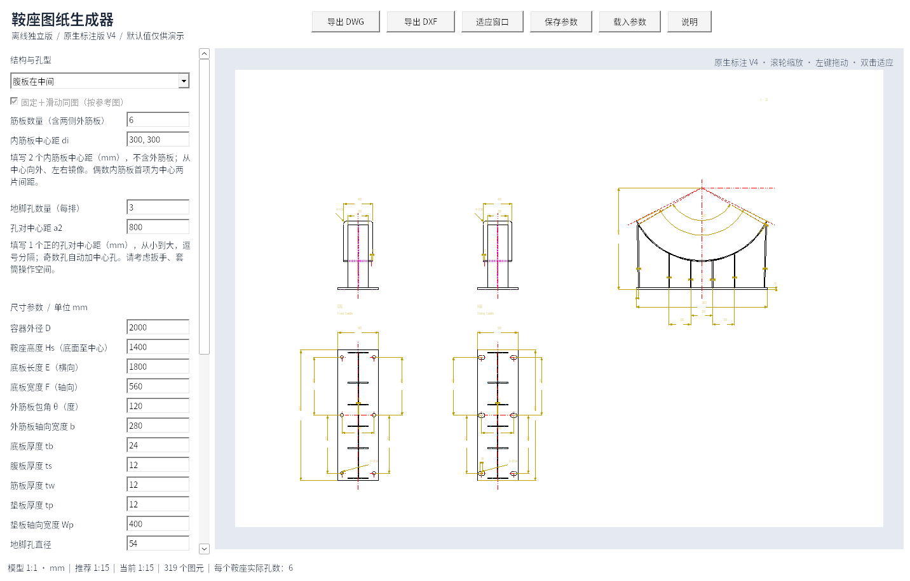
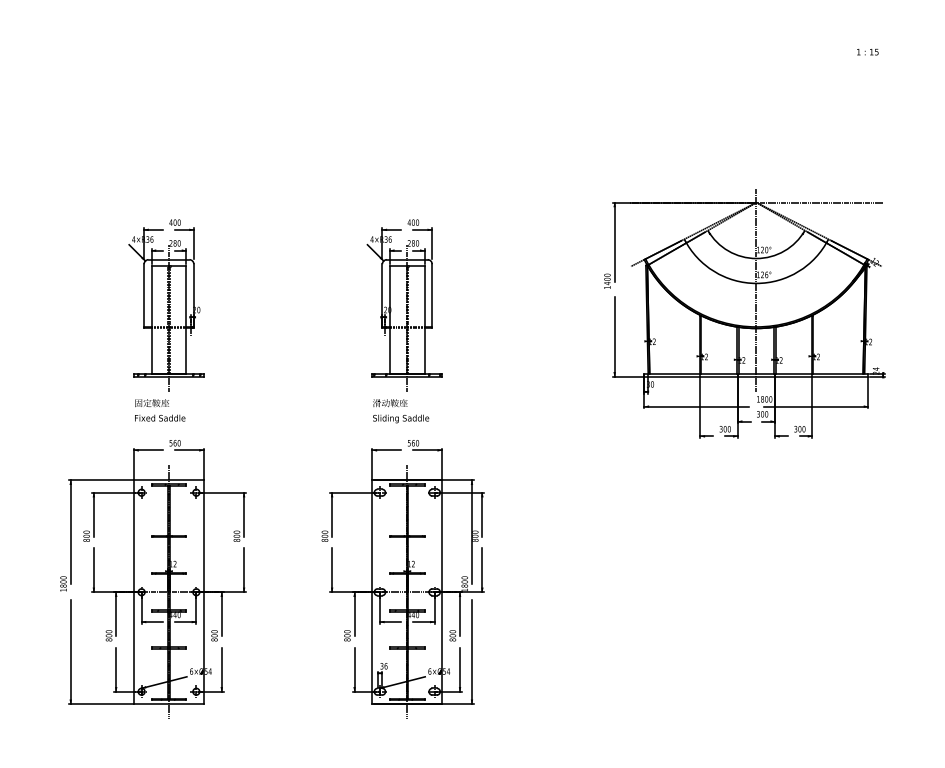

# 鞍座图纸生成器 V4

Windows 10/11 x64 离线单文件程序，无需 AutoCAD、Python 或联网运行。

## 下载

- **[单文件 EXE，直接下载运行](https://github.com/JaxonWang888/123/raw/refs/heads/main/releases/saddle-generator-v4.exe)**
- [完整程序包：说明、示例 DWG/DXF、参数和验证报告](https://github.com/JaxonWang888/123/raw/refs/heads/main/releases/saddle-offline-v4.zip)
- [完整对应源码和构建脚本](https://github.com/JaxonWang888/123/raw/refs/heads/main/releases/saddle-source-v4.zip)
- [SHA-256 校验值](releases/SHA256SUMS.txt)

将 EXE 放入 `C:\Users\20202012\Desktop\鞍座自动生成` 后双击运行。说明、示例与源码不是运行依赖。

## 本次更新

- 全部原生 CAD 尺寸统一为 `HM-ASME 1-1`、`6 尺寸线-管口号外圆（细实线）`，标注全局比例等于图纸比例，几何和测量比例保持 1:1。
- 删除排气孔端部偏移，改为垫板底部孔投影，左鞍座靠右、右鞍座靠左；体现垫板厚度、隐藏孔壁、遮挡部分与底板孔隐藏线。
- 纵向视图按筋板和腹板的真实投影高度绘制，中置腹板使用虚线，图下添加固定/滑动鞍座中英文名称。
- 外筋板端面垂直于内侧边，包角定义点落在真实接触点；内筋板按短边截平；增加连接容器中心的径向中心线。
- 地脚孔改用独立孔对中心距和螺孔列间距，奇偶孔自动对称；侧置腹板的孔列在底板中心线上。
- 允许筋板间布孔，校验实际几何干涉、重叠和越界，操作空间保留为提示。
- 腹板与筋板不交叉，中置腹板分隔内筋板，使用独立原生 `HATCH` 剖面，区域不叠加。
- 不显示向视图符号；自动比例选项直接显示具体推荐值；左侧滚动采用批量移动与统一重绘，减少残影和闪烁。

中文图纸文字宋体，英文与数字 Arial。继续不生成 Note、泡泡号、BOM、Ls 及多余引线注释；保留地脚孔数量直径与 Note8 的 50 mm 缺口判断。筋板数量改变后仍要求重新填写内筋板中心距。

## 验证与范围

20 组参数模型检查及补充几何检查通过；实际 Windows EXE 在 Wine 兼容环境通过 160 项交互与导出检查；21 组 DWG/DXF 共 42 份直接/回读文档通过独立测量、指定样式/图层/比例、孔定位、端面、隐藏投影和原生剖面检查，审计错误和修复均为 0。

尚未在用户的 Windows 实机或 AutoCAD 中验证。DWG/DXF 为 AutoCAD 2000 兼容格式。示例仅供演示，程序不执行结构强度计算。旧版本继续保留，建议下载带 v4 的文件以避免旧缓存。

## 许可证

程序及对应源码为 GPL-3.0-or-later，包括静态链接的 GNU LibreDWG、中文编码修复、内嵌参考样式、构建脚本和验证程序。第三方许可证随包提供；参考图资产保留其原有权属。
