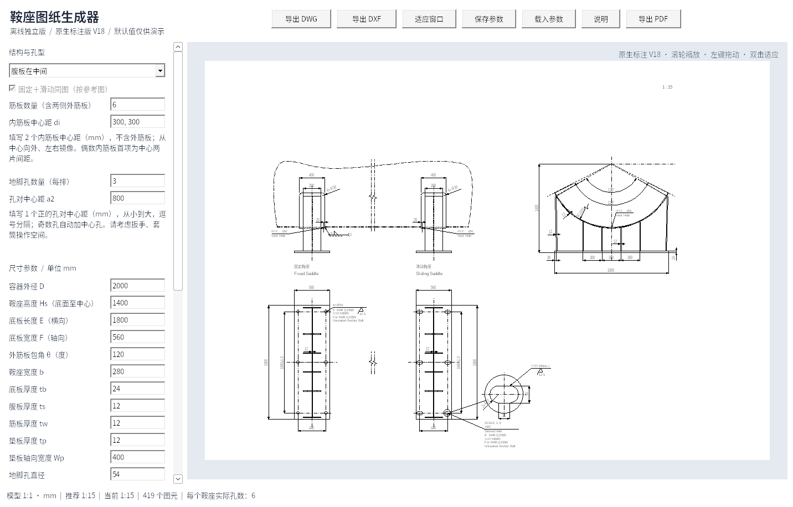
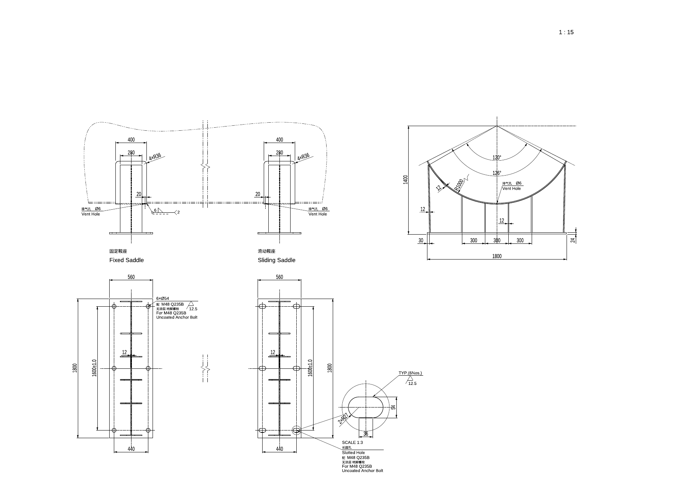

# 鞍座图纸生成器 V18

Windows 10/11 x64 离线单文件程序，无需 AutoCAD、Python 或联网运行。

## 下载

- **[单文件 EXE，直接下载运行](https://github.com/JaxonWang888/123/raw/refs/heads/main/releases/saddle-generator-v18.exe)**
- [完整程序包：说明、示例 DWG/DXF/PDF、参数和验证报告](https://github.com/JaxonWang888/123/raw/refs/heads/main/releases/saddle-offline-v18.zip)
- [完整对应源码和构建脚本](https://github.com/JaxonWang888/123/raw/refs/heads/main/releases/saddle-source-v18.zip)
- [SHA-256 校验值](releases/SHA256SUMS.txt)

将 EXE 放入 `C:\Users\20202012\Desktop\鞍座自动生成` 后双击运行。说明、示例与源码不是运行依赖。

## 本次更新：缩短下方断开线

下方每条断开线上下端点跨度改为底板长度的0.2倍，仍居中放置，与上方断开线对齐，保持“5 断开线（双点划线）”图层。

例如底板长1800时，跨度为360 mm。请用 V18 重新生成图纸。

DXF 为 2004 格式；DWG 含原生折弯半径扩展实体，请使用支持此标注类型的 CAD。

主图毫米模型 1:1，所有尺寸为 CAD 原生 DIMENSION / LARGE_RADIAL_DIMENSION，使用 HM 1-1，图层为“6 尺寸线-管口号外圆（细实线）”，全局比例等于图纸比例。仅长圆孔的放大复制图采用标示放大比例，标注仍显示孔的实际尺寸。中文宋体，英文数字 Arial。

保留之前的外筋板接触点、截平端面、实际投影、镜像侧腹板、对称孔、独立内筋板间距、非交叠原生剖面、自动比例具体值和滚动重绘。仍不生成 Note、BOM、泡泡号、Ls、向视符号及过程角度；排气孔、缺口、地脚孔注释和焊接符号保留，注释连接使用普通箭头和线条。

## 验证与使用范围

Windows EXE 在 Wine 10 中完成 177 项交互/导出检查；42 份常规 CAD 文档和 8 份比例文档独立审计错误与修复均为 0。独立重生成角度尺寸恢复为 450/650 mm 弧半径；1:2.5、1:5、1:25、1:40 的实体和样式全局比例均核对一致。25 份 DWG 原始文字流通过 Unicode 与字体检查，21 份 PDF 保持黑白矢量。完整数据和验证报告在程序包内。

当前环境没有 AutoCAD Mechanical 2018，尚未进行该软件的实机打开、重生成、编辑、保存和打印验收。默认参数仅作演示，不执行强度计算。PDF 文字转为字体轮廓，CAD 文字和标注可编辑。

GNU LibreDWG 及程序遵循 GPL-3.0-or-later；许可证和完整对应源码随包提供。历史版本在 releases 目录保留。
