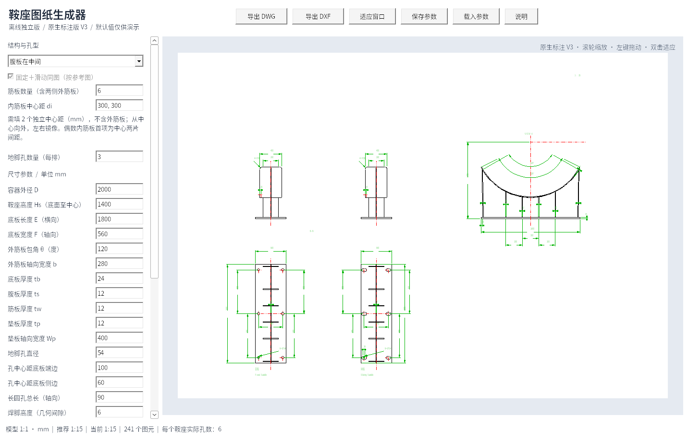
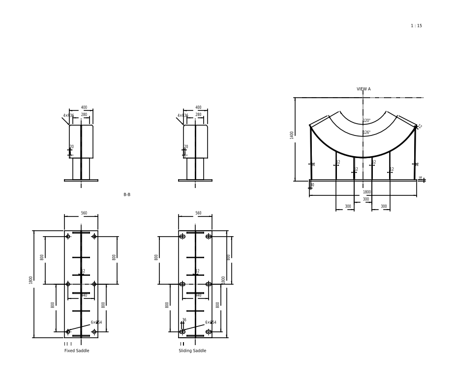

# 鞍座图纸生成器 V3

Windows 10/11 x64 离线单文件程序，无需 AutoCAD、Python 或网络。

## 下载

- **[单文件 EXE，直接下载运行](https://github.com/JaxonWang888/123/raw/refs/heads/main/releases/saddle-generator-v3.exe)**
- [完整程序包：说明、示例 DWG/DXF、参数与验证报告](https://github.com/JaxonWang888/123/raw/refs/heads/main/releases/saddle-offline-v3.zip)
- [完整对应源码和离线构建脚本](https://github.com/JaxonWang888/123/raw/refs/heads/main/releases/saddle-source-v3.zip)
- [SHA-256 校验值](releases/SHA256SUMS.txt)

将 EXE 放到 `C:\Users\20202012\Desktop\鞍座自动生成` 后双击运行。说明、示例及源码不是运行依赖。

## V3 更新

- 所有尺寸均为原生 CAD DIMENSION，采用真实定义点和实际测量值；模型毫米尺寸 1:1，测量比例为 1。
- a1 为排气孔中心距垫板侧边；每个非中心地脚孔标 a2；a3 为两列孔中心距；a4 为长圆孔直线段；Ls 删除。
- 删除全部 Note/注、泡泡号及箭头、BOM 和其他引线注释；保留地脚孔数量和直径标注。
- 中文图纸字体为宋体，英文与数字为 Arial，使用 Windows 系统字体。保留参考图层、线型及样式表，当前尺寸采用 HM 1-1 标注样式。
- 内筋板中心距从中心向外独立输入，左右镜像，不含外筋板；筋板数量改变后清空间距，重新输入后才能导出。
- 垫板上角圆角方向已修正。侧置腹板的左鞍座腹板在左侧、右鞍座腹板在右侧。
- Note8 使用外筋板内表面与接触点切线的锐角判断缺口：小于 20° 时采用 50 mm 径向边，延长线通过容器中心；不显示 Deg-3 和相邻 90°。
- 中置腹板的孔数为单排数量，实际每个鞍座为输入值×2。固定/滑动鞍座同图；支持实时更新、缩放拖动、推荐比例及手动比例。

## 验证与范围

24 组参数模型检查及补充几何检查通过；Windows EXE 通过 67 项交互/导出检查；17 组 DWG/DXF（含缺口样例）共 34 份直接/回读文档通过独立测量、原生标注、字体、孔数与审计检查。

Windows EXE 在 Wine 10 兼容环境中执行，尚未在用户 Windows 实机或 AutoCAD 中验证。DWG/DXF 为 AutoCAD 2000 兼容格式。默认值及示例用于演示，程序不执行结构强度计算。

V2 历史版本仍保留在 releases 目录。建议本次下载带 v3 的文件以免复用旧缓存。

## 许可证

程序及对应源码为 GPL-3.0-or-later，包含静态链接的 GNU LibreDWG、中文编码修复、内嵌参考样式、构建脚本与验证程序。第三方许可证随包提供；参考图资产保留原有权属。
