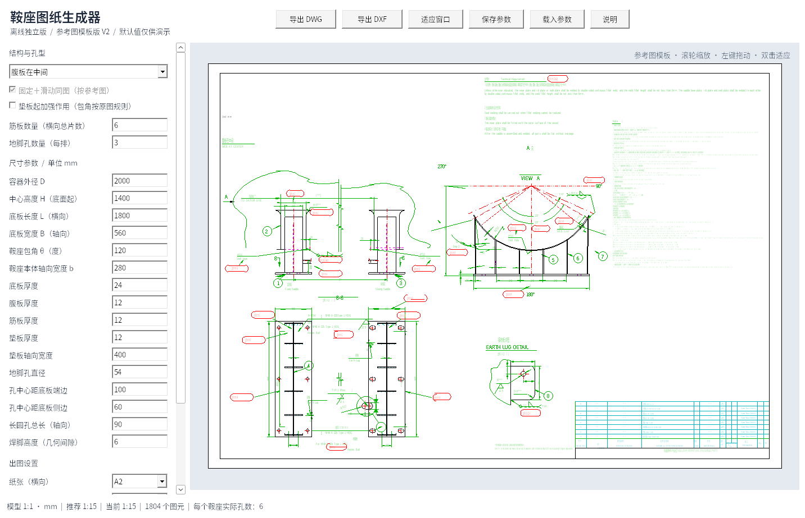

# 鞍座图纸生成器 V2

Windows 10/11 x64 离线单文件程序，无需安装 AutoCAD 或联网运行。

## 下载 V2

- [离线程序、说明和示例](https://github.com/JaxonWang888/123/raw/refs/heads/main/releases/saddle-offline-v2.zip)
- [完整对应源码](https://github.com/JaxonWang888/123/raw/refs/heads/main/releases/saddle-source-v2.zip)

解压后，将“鞍座图纸生成器.exe”放到 `C:\Users\20202012\Desktop\鞍座自动生成`，双击运行。说明、示例、源码均不是程序运行依赖。

## 本次更新

- 改为参考图模板：同图保留固定/滑动鞍座、剖视、接地详图、技术要求及明细栏的编排。
- 沿用原图 41 个图层、14 个文字样式和 37 个标注样式定义；主要参数、颜色、线型、线宽和线型比例已核对。
- 中置腹板孔数改为**每排数量**，实际每个鞍座总数为输入值 × 2；输入 3 时，固定和滑动方案各有 6 个孔。
- 侧置腹板仍为单排，输入即每个鞍座的孔总数。
- 支持实时参数更新、缩放/平移、纸张推荐比例和手动比例、DWG/DXF 导出；导入 V1 参数时迁移旧孔数语义。

## 范围与验证

24 组模型检查、59 项 Windows EXE 检查，以及 16 组 DWG 几何、中文和主要制图属性回读比对通过。Windows EXE 在 Wine 兼容环境中执行，尚未在用户实机或 AutoCAD 中验证。

DWG 为原生 AutoCAD 2000 兼容格式；DXF 为 2018 格式并保留完整样式表。DWG 2000 无法存储所有 2018 新增标注属性；原图由线/箭头/MTEXT 组成的标注沿用原绘制方式。参考组合块展开为实体，不保留原对象句柄与关联约束。

原图没有给定数值的项目专用详图尺寸、材料、图号等保留占位符。原 SHX 字体文件未随参考图提供，保留字体引用，独立预览使用系统字体。本程序不执行承载/强度计算，默认尺寸与示例仅供演示。

## 许可证

程序及对应代码按 GPL-3.0-or-later 提供。源码包含内嵌模板数据、GNU LibreDWG 对应源码、中文编码修复、构建脚本和检查程序。第三方许可证随包提供；参考图资产保留其原有权属。
