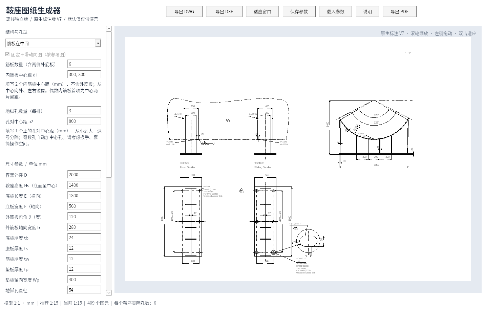
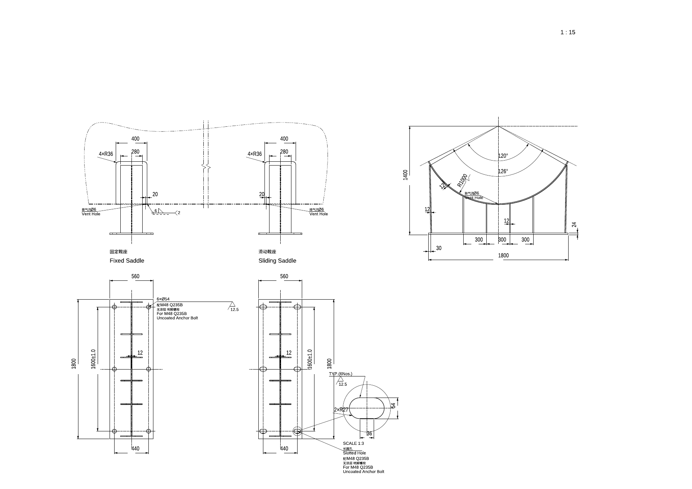

# 鞍座图纸生成器 V7

Windows 10/11 x64 离线单文件程序，无需 AutoCAD、Python 或联网运行。

## 下载

- **[单文件 EXE，直接下载运行](https://github.com/JaxonWang888/123/raw/refs/heads/main/releases/saddle-generator-v7.exe)**
- [完整程序包：说明、示例 DWG/DXF/PDF、参数和验证报告](https://github.com/JaxonWang888/123/raw/refs/heads/main/releases/saddle-offline-v7.zip)
- [完整对应源码和构建脚本](https://github.com/JaxonWang888/123/raw/refs/heads/main/releases/saddle-source-v7.zip)
- [SHA-256 校验值](releases/SHA256SUMS.txt)

将 EXE 放入 `C:\Users\20202012\Desktop\鞍座自动生成` 后双击运行。说明、示例与源码不是运行依赖。

## 本次更新

腹板在侧面时，下方投影视图中的腹板两端止于外侧筋板内表面，不再延伸到底板边缘。腹板轮廓、剖面填充和干涉检查同步使用实际截短范围，固定及滑动鞍座保持镜像一致，随筋板几何参数实时调整。

保留之前的普通注释箭头、左侧焊接符号、原生折弯半径、缺口尺寸位置与靠近主图的长圆孔放大图，以及黑白预览和离线 PDF 导出。

DXF 为 2004 格式；DWG 含原生折弯半径扩展实体，请使用支持此标注类型的 CAD。

主图毫米模型 1:1，所有尺寸为 CAD 原生 DIMENSION / LARGE_RADIAL_DIMENSION，使用 HM-ASME 1-1，图层为“6 尺寸线-管口号外圆（细实线）”，全局比例等于图纸比例。仅长圆孔的放大复制图采用标示放大比例，标注仍显示孔的实际尺寸。中文宋体，英文数字 Arial。

保留之前的外筋板接触点、截平端面、实际投影、镜像侧腹板、对称孔、独立内筋板间距、非交叠原生剖面、自动比例具体值和滚动重绘。仍不生成 Note、BOM、泡泡号、Ls、向视符号及过程角度；排气孔、缺口、地脚孔注释和焊接符号保留，注释连接使用普通箭头和线条。

## 验证与使用范围

20 组参数模型检查及补充检查通过；Windows EXE 在 Wine 10 中完成 169 项交互/导出检查。21 组 DWG/DXF 生成并回读，均含原生折弯半径实体，42 份文档独立审计错误与修复均为 0。21 份 PDF 经独立解析和渲染检查，确认为黑白矢量、A2 纸张和不同线宽。完整报告在程序包内。

尚未在用户 Windows 实机或 AutoCAD 中验证；不承诺旧 AutoCAD 2000 的折弯半径兼容性。默认参数仅作演示，不执行结构强度计算。PDF 文字转为字体轮廓，CAD 文字和标注可编辑。

GNU LibreDWG 及程序遵循 GPL-3.0-or-later；许可证和完整对应源码随包提供。历史版本在 releases 目录保留。
